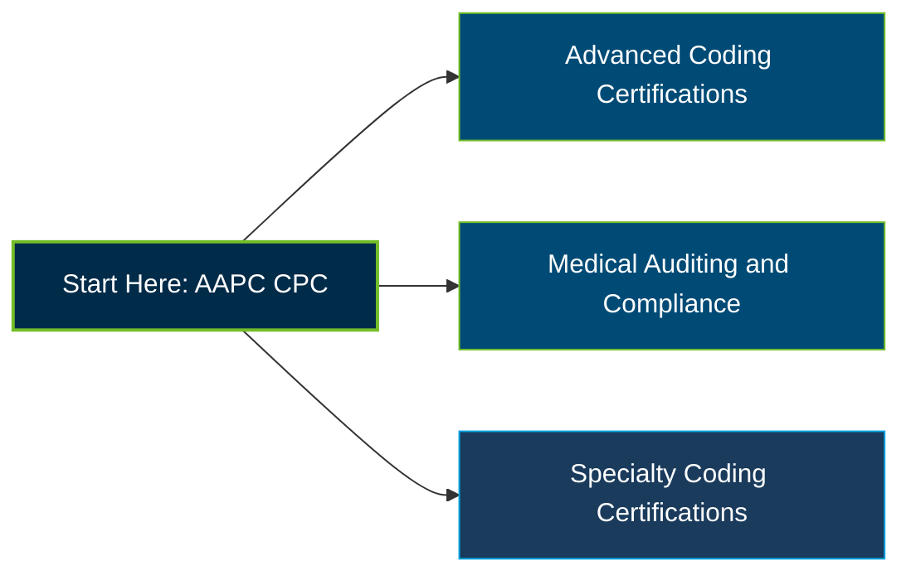

# AAPC CPC Certification Exam Guide

A dedicated medical coding study guide and knowledge reference for candidates preparing for the **AAPC Certified Professional Coder (CPC) Certification Exam**, covering outpatient coding, clinical documentation, coding guidelines, and reimbursement compliance.

---

## Exam Overview

The AAPC Certified Professional Coder (CPC) certification validates medical coding knowledge for outpatient and physician services. It assesses the application of ICD-10-CM, CPT, and HCPCS Level II codes, along with coding guidelines, compliance, and medical record interpretation.

- **Exam Format**: Multiple-choice examination; online with a live remote proctor or at a testing center, with approved medical code books
- **Target Audience**: Aspiring and experienced medical coders, outpatient coding specialists, and healthcare professionals moving into medical coding
- **Prerequisites**: AAPC recommends knowledge of medical terminology, anatomy, and pathophysiology; its prerequisite courses are recommended but not required

---

## Core Exam Domains & Knowledge Areas

### 1. Medical Terminology and Anatomy

- Medical terminology across body systems and clinical documentation.
- Anatomy and physiological structures relevant to diagnosis and procedure coding.
- Interpreting medical records and identifying relevant clinical details.

### 2. Compliance, Regulatory Requirements, and Coding Guidelines

- HIPAA, fraud and abuse, Medicare regulations, and applicable compliance requirements.
- ICD-10-CM Official Guidelines, CPT conventions, parenthetical notes, and sequencing.
- Modifiers, National Correct Coding Initiative (NCCI) edits, and coverage policies.

### 3. ICD-10-CM and HCPCS Level II

- Diagnosis coding across ICD-10-CM chapters and body systems.
- HCPCS Level II codes for supplies, medications, services, and applicable modifiers.
- Selecting codes according to documentation, code-set rules, and medical necessity.

### 4. CPT Surgical Procedure Coding

- CPT 10000 series: integumentary system procedures.
- CPT 20000–50000 series: musculoskeletal, respiratory, cardiovascular, digestive, urinary, reproductive, and endocrine procedures.
- CPT 60000 series: nervous system procedures and related coding guidance.

### 5. Radiology, Pathology, Laboratory, and Medicine

- Diagnostic and interventional radiology procedures and services.
- Pathology and laboratory testing, including chemistry, hematology, microbiology, and related services.
- Medicine coding for specialty services, therapeutic procedures, and other clinical services.

### 6. Evaluation and Management (E/M) and Anesthesia

- E/M coding for office visits, outpatient services, inpatient care, emergency departments, and critical care.
- Anesthesia time reporting, physical status modifiers, and qualifying circumstances.
- Applying documentation and coding rules to accurately report professional services.

### 7. Medical Record Coding Cases

- Applying CPT, ICD-10-CM, and HCPCS Level II codes to clinical documentation.
- Connecting diagnoses and procedures while following coding conventions.
- Reviewing case details for code accuracy, completeness, and compliance.

---

## Certification Path

The following is a suggested professional development progression, not an official mandatory AAPC certification sequence.

---

## Recommended Practice & Study Resources

Build a strong foundation with official AAPC materials, supplementary practice, and regular application of current coding guidelines.

- **CertsGate**: Explore [AAPC CPC certification preparation resources](https://certsgate.com/exams/aapc/cpc) for supplementary practice questions and study materials to help review knowledge gaps.
- **Practical Study Resource**: Practice coding documented outpatient cases using current CPT Professional, ICD-10-CM, and HCPCS Level II references, following AAPC's permitted-materials guidance.

